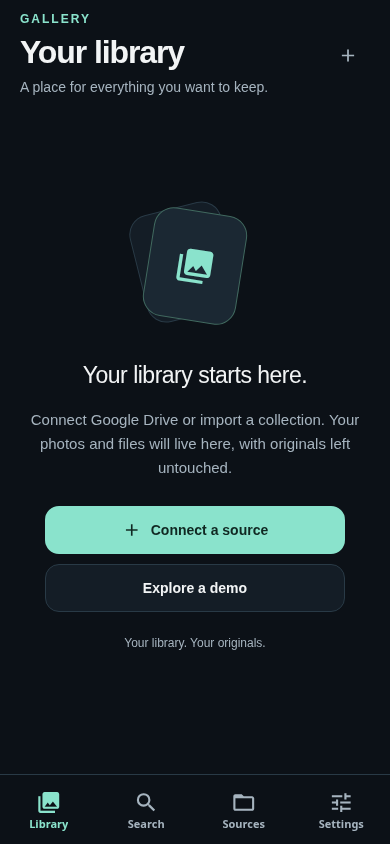
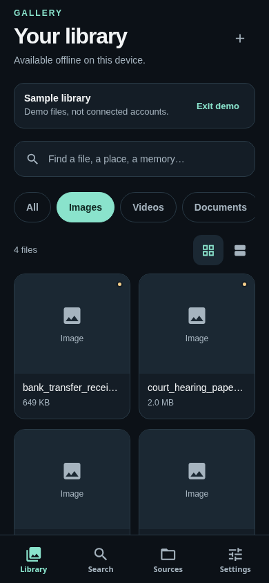

# Gallery usability pass (approved direction: user's “Go ahead”)

Keep Expo/React Native and the current service contracts. Use a consistent quiet dark
palette, Gallery branding, readable type, and four primary tabs: Library, Search, Sources,
Settings. Preserve old routes as secondary destinations so links still work.

Library becomes the first screen: image-led responsive cards, All/Images/Documents/Review
filters, working grid/list toggle, clear file counts, and file details with real previews.
No auto-seeded user library. Offer demo data explicitly and mark it as samples; exiting demo
must preserve real imports and annotations.

Sources leads with Google Drive connection, lists independently linked accounts and reads
provider files through existing signed Gallery routes. Drive listings remain source-only,
not canonical assets. Import a Gallery collection remains available with a clear supported
format, cancellation, errors and success. Avoid advertising unimplemented device scanning.

Search stays deterministic offline, with private AI optional and honest local fallback.
Settings focuses on local storage and actual service health rather than schema/companion
internals. Detail views retain provenance, review decisions and immutable identity.

Plan: preserve repair commit; test first-run/demo rules; implement shared visual components
and library; wire source listing; simplify remaining screens; run app/Python/type/lint/build,
production web export and real browser checks at mobile and desktop widths. Check native
bundle compatibility; do not claim native-device or live AWS acceptance. No deployment.

## Implemented

- Shared dark palette, accessible labelled controls, visible keyboard focus, responsive
  virtualized image-first grid and list, and four primary tabs. Existing /library and /images
  links remain supported as secondary routes.
- First launch is empty; demo is explicit and labelled. Exiting demo removes only fixture
  records, retaining real imports and annotations. Existing caches are preserved.
- Drive accounts list and source-only media browser use existing owner-scoped signed API
  routes. Drive previews do not become canonical catalogue records. JSON collection import
  retains its validated bounded format and durable atomic merge.
- Search has persistent input labels and grounded offline results. File details show actual
  imported previews, review actions, descriptions, tags and expandable provenance.
- Settings reports real Node/API and private-AI availability. Removed invented model names
  and runtime-only internals from the main user flow.
- Catalogue changes serialize before persistence; failed writes retain prior state. Added
  a JSON-data clone fallback for runtimes without structuredClone and fixed same-origin
  session creation when no explicit API URL is supplied.

## Verification and limitations

Fresh command results are recorded in the task completion report. Browser scripts and their
local setup are documented in tests/browser/README.md. Drive listing/media tests mock the
provider boundary; live consent, deployed sessions, account recovery and backend ingestion
are not established by them.

The configured production health URL could not be reached from Cloud: the inherited proxy
rejected the HTTPS CONNECT with 403, before an origin response. This environment has no
injected AWS/Google secrets, private network grants, attached native device or Remote host.
Do not infer that the AWS instance is down. To verify it, allow the actual host in the Cloud
configuration or attach an authorized executor with access, then check the live API, OAuth
callbacks and durable source/catalogue storage on the Ubuntu host.

No app deployment, infrastructure changes, merge or release publishing is part of this task.

Final local verification: 99 Python tests and 89 app tests pass; TypeScript passes; ESLint has
zero errors and five inherited warnings. Node build, production web export and Android Hermes
JavaScript export pass. Production static-web hydration/keyboard smoke passes; the icon font
SSR mismatch found during this check was fixed with Expo font registration before rendering.
This is included in GitHub CI. Responsive browser checks passed at 320, 390 and 1280 px.
The source acceptance script passed its explicit-demo, collection/review persistence,
offline Ask and mocked separate Drive-account journeys with structuredClone absent.

The Android export is a JavaScript/Hermes bundle, not an installed APK, emulator run or device
acceptance result. Physical-device and live AWS checks remain outstanding as described above.

## Production web captures

The first capture is a fresh empty library. The second is the explicitly labelled demo;
these are sample records, not connected Google accounts or fetched user photos.

